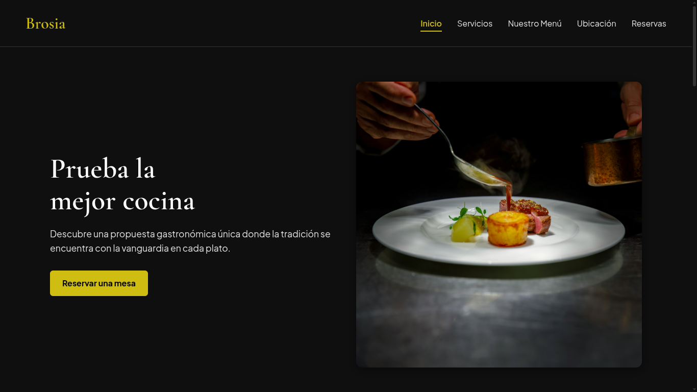

# 🍷 Brosia | Sitio Web para Restaurante de Autor

Brosia es una propuesta de landing page premium desarrollada bajo un enfoque estricto de maquetación limpia, semántica y alto rendimiento. El proyecto simula la presencia digital de un restaurante de alta cocina, priorizando la accesibilidad, la optimización del flujo de renderizado en el navegador y una experiencia de usuario (UX) fluida y sofisticada.

## 🖼️ Vista Previa del Sitio

<p align="center">
  
</p>

## 🚀 Características principales

- **Maquetación Semántica y Accesible:** Implementación avanzada de etiquetas nativas de HTML5 (`figure`, `figcaption`, `address`, `dialog`) con soporte accesible mediante atributos ARIA (`aria-live`, `aria-label`).
- **Menú Navegación Inteligente (Sticky Header & ScrollSpy):** Encabezado fijo con efecto de desenfoque (*glassmorphism*) e indicador de enlace activo dinámico mediante la API nativa `Intersection Observer`.
- **Cartas del Menú Interactivas (JSON + Modales):** Renderizado dinámico de la propuesta gastronómica consumiendo datos desde un archivo JSON asíncrono a través de elementos `<dialog>` nativos animables.
- **Sistema de Reservas Directo y Seguro:** Formulario con selección interactiva de fecha mediante un calendario personalizado incrustado, contador de personas/hora, validación de datos en tiempo real y arquitectura de envío directo mediante la API oficial de Web3Forms (`FormData` y `fetch`), optimizada para evitar bloqueos por firewalls/Cloudflare.
- **Sincronización con WhatsApp:** Alternativa integrada para coordinar y enviar la reserva estructurada directamente a la línea de atención oficial del restaurante.
- **Gestión de Scroll con Retención:** Bloqueo estricto del desplazamiento en el `body` al abrir componentes modales, conservando la posición exacta de lectura sin saltos de pantalla (*layout shifts*).
- **Animaciones y Rendimiento Optimizado:** Animaciones refinadas con soporte de `@starting-style`, revelado progresivo de secciones (*Scroll Reveal*) y escuchadores de eventos optimizados mediante `requestAnimationFrame`.

## 🛠️ Tecnologías utilizadas

- **HTML5 Estricto:** Estructura de alta fidelidad semántica optimizada para SEO técnico y accesibilidad universal.
- **CSS3 Arquitectónico:** Uso intensivo de Design Tokens con variables CSS (`:root`), CSS Grid para galerías, Flexbox, microinteracciones adaptadas a dispositivos táctiles/escritorio (`@media (hover: hover)`) y transiciones nativas de `<dialog>`. Sin dependencias o frameworks externos.
- **JavaScript (ES6+ Modular):** Arquitectura limpia basada en ES Modules (`import`/`export`), manipulación eficiente del DOM con `DocumentFragment`, APIs nativas (`Fetch API`, `Intersection Observer`) y delegación de eventos.
- **Web3Forms API:** Integración directa en el cliente para el procesamiento y entrega instantánea de correos de reserva.

## 🏗️ Estructura del Proyecto

Arquitectura modular desarticulada por componentes y responsabilidades:

```text
brosia/
├── assets/               # Recursos estáticos del sitio
│   ├── brand/            # Identidad visual y logotipo
│   ├── icons/            # Íconos y favicon del proyecto
│   └── img/              # Fotografías de alta resolución optimizadas
├── css/                  # Estilos arquitectónicos
│   └── style.css         # Hoja de estilos principal estructurada con variables
├── js/                   # Lógica modular en JavaScript
│   ├── data/             # Fuentes de datos estáticas
│   │   └── menu.json     # Estructura JSON con las categorías y platos del menú
│   ├── modules/          # Módulos ES6 funcionales
│   │   ├── booking.js    # Lógica del formulario, contadores y envío asíncrono
│   │   ├── calendar.js   # Renderizado y control del calendario dinámico
│   │   ├── menu-modal.js # Petición asíncrona y renderizado de la carta
│   │   └── ui-effects.js # Scroll Lock, ScrollSpy, Scroll Reveal y ScrollTop
│   └── main.js           # Punto de entrada principal (Entry Point)
├── .gitignore            # Exclusión de archivos sensibles y temporales para Git
├── index.html            # Estructura semántica unificada en español
├── LICENSE               # Licencia del proyecto
└── README.md             # Documentación del repositorio
```

## 💻 Cómo ejecutarlo

1. Clona este repositorio en tu máquina local.
  ```bash
  git clone https://github.com/edwingarcia14/brosia.git
  ```
2. Abre el proyecto utilizando un servidor local (como la extensión **Live Server** en VS Code o un servidor local en Node.js/Python) para que la carga modular de JavaScript (`type="module"`) y la petición `fetch` del archivo `js/data/menu.json` funcionen correctamente sin restricciones de CORS.
3. No requiere ningún comando de compilación o instalación de dependencias, ya que utiliza tecnologías nativas del navegador.

## 🔒 Seguridad y Configuración de Web3Forms

El envío de reservas funciona directamente desde el navegador del cliente mediante la clave pública de Web3Forms:

- La clave pública (`access_key`) está configurada en `js/modules/booking.js`.
- **Protección de Seguridad:** Para evitar el uso no autorizado de tu clave en otros sitios web, debes registrar tu dominio desplegado (ejemplo: `https://brosia.vercel.app`) dentro del **Domain Whitelist** (Lista blanca de dominios) en el panel de control de **Web3Forms**.

## 📝 Licencia

Este proyecto está bajo la Licencia MIT. Consulta el archivo [LICENSE](LICENSE) para más detalles.

---
<p align="center">
  
  <br />
  <sub><b>Desarrollado por Edwin García</b> | 2026</sub>
</p>
